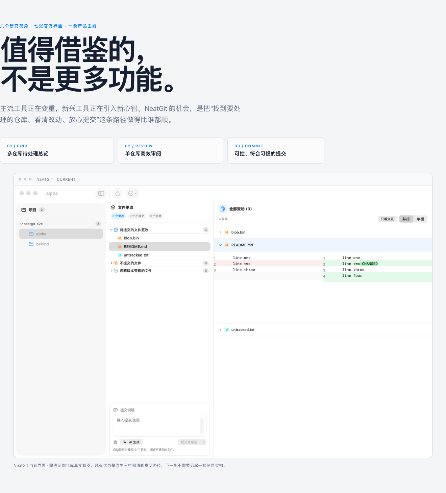
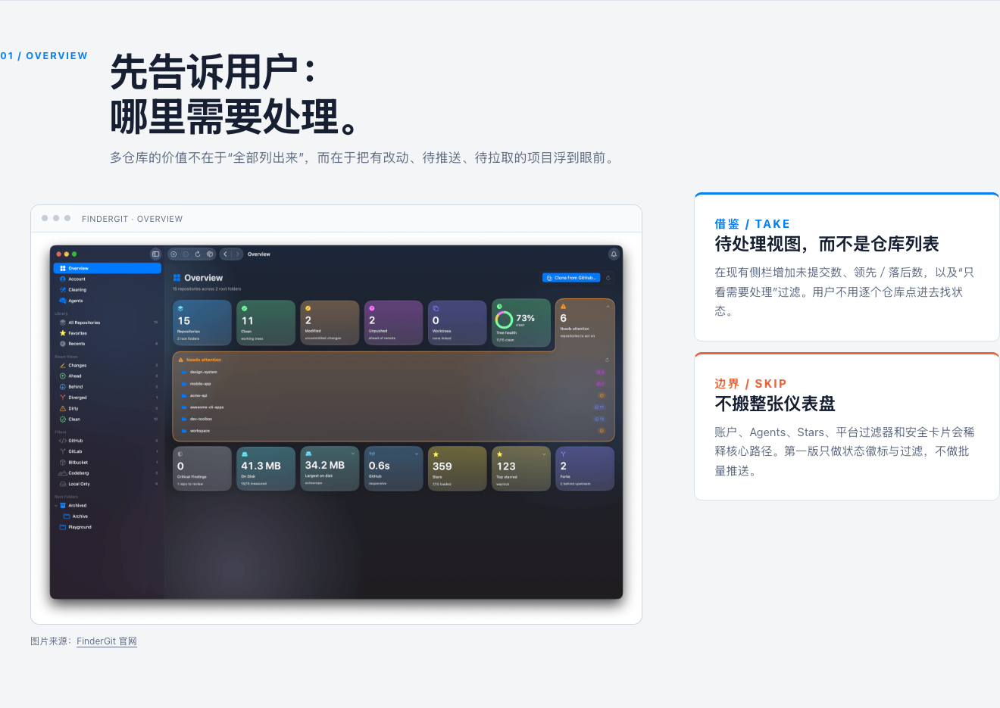
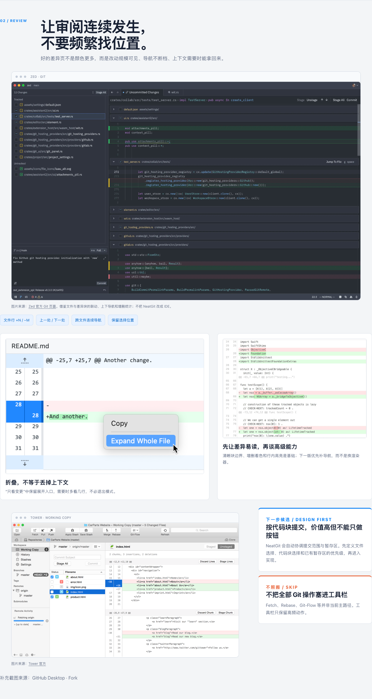
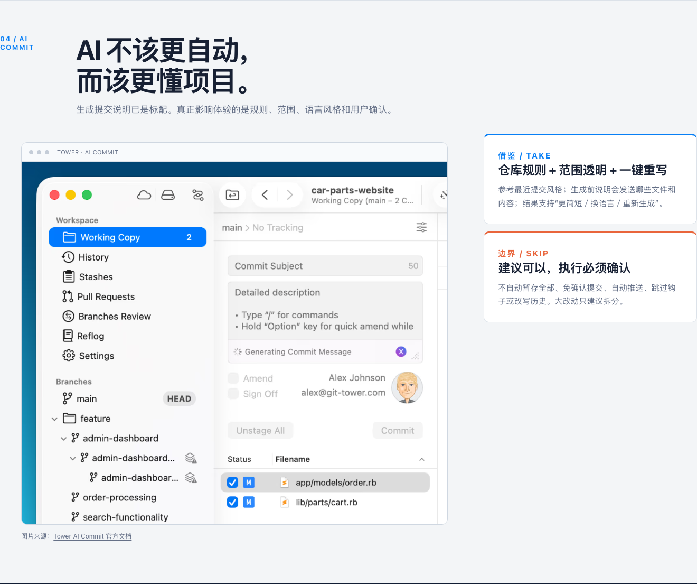
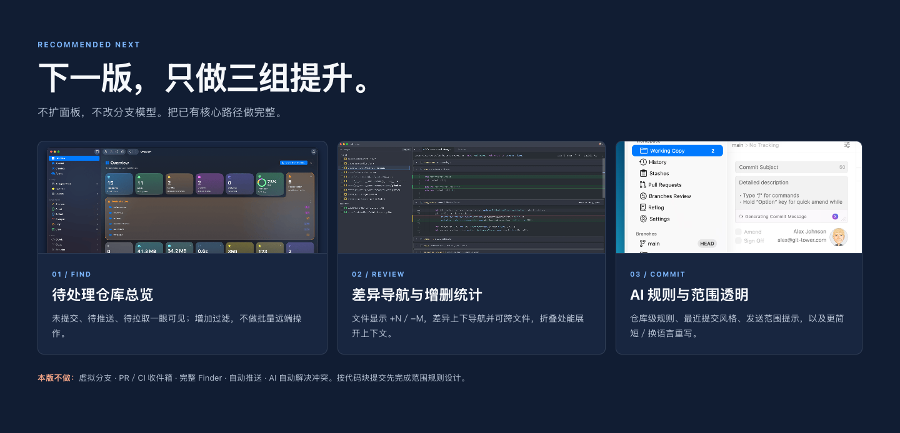

# Git 客户端竞品调研（2026-11）

> 调研日期：2026-11-27。六个并行研究方向：主流桌面客户端、新兴工作流、差异审阅、AI 提交、用户口碑、原生新锐竞品。
> 本文是产品建议，不代表功能已拍板或承诺实施。竞品能力主要来自官方文档与更新记录，未逐款安装实测；社区评价只用于识别问题，不作为普遍事实。

## 图文速览

**[打开完整图文版](GIT_CLIENT_COMPETITIVE_RESEARCH.html)** · **[查看整页长图](assets/competitive-research/visual-report.png)**

### 01 · 多仓库待处理总览

### 02 · 差异审阅效率

### 03 · 新工作流与安全网

### 04 · AI 提交能力

### 下一版建议

---

## 核心判断

NeatGit 最有机会的定位不是“另一个全功能 Git 客户端”，而是：

**多仓库待处理总览 → 单仓库高效审阅 → 可控、符合项目习惯的提交。**

理由：Fork、Tower 等成熟产品持续把投入放在平台集成和低频历史操作；GitButler 的虚拟分支带来新心智成本；AI commit 已被 GitKraken、Copilot、JetBrains 等普遍内置，单独作为卖点已不足。NeatGit 已有多仓库发现和原生三栏，应先把这条核心路径做深，而不是横向堆面板。

## 第一优先级：高价值、可小步落地

| 建议 | 最小产品形态 | 借鉴来源与理由 |
|---|---|---|
| 多仓库“待处理”总览 | 仓库行显示未提交数、领先/落后数；增加“只看有改动 / 待推送 / 待拉取”过滤，分叉明确警示。先不做批量推送 | FinderGit 的待处理视图、Fork 的同步计数；直击多仓库用户找项目的真实成本 |
| 差异导航与规模预览 | 文件行显示 `+N / −M`；上一处/下一处差异，文件末尾可继续到下一文件并同步选择；“只看变更”中可展开更多上下文 | JetBrains、Zed、GitHub Desktop；提升每次提交前审阅速度，不增加新面板 |
| AI 生成规则与范围透明 | 支持全局及仓库级自定义指令，参考最近提交标题；生成前显示纳入文件数、发送内容与截断情况；提供“更简短 / 换语言 / 重新生成” | GitKraken、VS Code、JetBrains、GitButler 均已重视指令；NeatGit 的自动提交范围更需要显式说明 |
| 原生快捷键补全核心路径 | 快速打开仓库、聚焦提交说明、确认提交、刷新；文件可 Quick Look，优先覆盖图片和文本 | Tower、Fork、FinderGit；提高高频操作效率，比增加低频 Git 子命令更有价值 |
| 非文本文件的明确出口 | 显示文件类型、大小和“无法展示文本差异”，提供“用默认应用打开”；图片再补旧版/新版并排 | Sublime Merge、Fork、Tower；先解决可理解性，不必支持任意二进制比较 |
| 操作状态更可见 | 每仓库操作串行；按钮区分进行中、成功、失败，长操作可取消，失败可查看原因 | FinderGit 的操作反馈；避免多仓库场景下误点与状态不明 |

**建议的下一版组合**：只做“待处理总览 + 差异导航与增删统计 + AI 规则/范围透明”三组，能形成完整且容易感知的产品提升。

## 第二优先级：价值高，但需先设计边界

1. **按代码块纳入提交**：lazygit、GitButler、VS Code、GitHub Desktop 都证明其价值，但 NeatGit 当前会自动同步提交范围与暂存区。先定义“文件选择、代码块选择、已有暂存区”谁优先，再实现；不能只在差异页加一个开关。
2. **工作区（worktree）归组**：GitHub Desktop 与 GitButler 的近期更新都响应了并行工作区和编码代理趋势。可把同一仓库的多个工作目录在左栏归组并标分支，不做完整 worktree 管理器。
3. **本地提交安全网**：仅对未推送的最近一次提交提供“撤销提交但保留改动”，清楚说明后果并保留恢复入口。不要承诺一键撤销推送、变基或远端历史。
4. **AI 拆分建议**：混杂改动可建议文件分组，由用户确认后分别生成；不自动改写暂存区或连续创建提交。
5. **冲突安全通道**：先做到识别、解释、打开外部工具与可回退，再考虑三栏合并器。不要把 AI 自动解决冲突作为捷径。

## 可后排的小改进

- `.gitignore` 模板选择器（Fork），延续现有轻量规则写入。
- 提交说明中的文件路径补全（Gitfox），不接平台账号和议题系统。
- 改写未推送最近提交的说明，结果仍需人工编辑确认。
- 仓库体积和维护信息只读展示；一键优化与历史重写暂不跟进。

## 暂不建议借鉴

- 虚拟分支、更换 jj 后端、自动重建 stacked branches / PR 合并队列：复杂度和新心智成本偏离标准 Git 的轻量定位。
- GitHub 账户主页、PR / Issue / CI / Dependabot 收件箱：长期平台适配成本会把产品拖向重型客户端。
- 完整 Finder 替代品、全盘垃圾清理、仓库历史重写按钮：超出核心提交路径并扩大误操作面。
- AI 自动暂存、免确认提交、自动推送、跳过钩子、自动冲突解决或历史整理：突破用户控制边界。
- 多 AI 代理面板、通用聊天、AI 代码占比审计：不是本地提交工作流的必要能力。
- 在单文件审阅尚未顺畅前做多文件巨型差异页或直接编辑器：先解决导航、上下文与提交范围。

## 市场与口碑证据

- GitHub 官方 API（2026-11-27 复核）：lazygit **84,118** stars、GitHub Desktop **22,148**、GitButler **22,032**。Stars 只代表粗略关注度，不等于满意度或活跃用户；另一份初报把 Desktop 误写成 221,148，已纠正。
- FinderGit 是很接近的直接竞品：原生、多仓库、Quick Look、待处理视图和 AI 规则更新频繁；其下载量与发布数量为官网自报，不能视作独立市场验证。它偏全局总览，NeatGit 可差异化于审阅深度、自带模型配置和中文体验。
- 社区较稳定的信号是：重型客户端因复杂和卡顿被放弃，过于基础的工具又无法覆盖审阅与拆分；GitButler 的撤销受好评，但新模型需要学习。单帖抱怨不作为普遍结论。
- AI commit 已商品化。更值得投入的是项目风格、范围透明和用户补充“为什么”，而不是再增加一个生成按钮。

## 主要来源

### 官方文档与更新记录

- Fork：https://git-fork.com/releasenotes
- Tower：https://www.git-tower.com/release-notes ；快捷键：https://www.git-tower.com/help/guides/faq-and-tips/keyboard-shortcuts/mac
- Gitfox：https://www.gitfox.app/release-notes
- Sublime Merge：https://www.sublimemerge.com/download
- GitHub Desktop worktrees：https://github.blog/changelog/2026-06-26-github-desktop-3-6-worktrees-and-deeper-copilot-integration ；提交与部分提交：https://docs.github.com/enterprise-cloud@latest/desktop/making-changes-in-a-branch/committing-and-reviewing-changes-to-your-project-in-github-desktop
- GitButler 0.23：https://blog.gitbutler.com/gitbutler-0-23 ；AI：https://docs.gitbutler.com/features/branch-management/ai-assistance
- lazygit 0.66：https://github.com/jesseduffield/lazygit/releases/tag/v0.66.0
- JetBrains 差异：https://www.jetbrains.com/help/idea/differences-viewer.html ；AI 版本控制：https://www.jetbrains.com/help/ai-assistant/ai-in-vcs-integration.html
- Zed Git：https://zed.dev/docs/git ；https://zed.dev/blog/git
- VS Code 暂存与提交：https://code.visualstudio.com/docs/sourcecontrol/staging-commits
- GitKraken AI：https://help.gitkraken.com/gitkraken-desktop/gkd-gitkraken-ai
- FinderGit：https://findergit.app/docs ；仓库列表：https://findergit.app/docs/repository-list ；AI：https://findergit.app/docs/ai-commit-messages ；发布记录：https://github.com/gfazioli/findergit-website/releases

### 社区与长期问题（证据强度低于官方功能事实）

- Git 客户端选择讨论：https://www.reddit.com/r/git/comments/1inut0b/what_git_client_do_you_use
- lazygit 使用体验：https://news.ycombinator.com/item?id=45878578
- GitButler 长期评测：https://www.lucasaguiar.xyz/posts/gitbutler-review-alternatives
- 多仓库管理长期问题：https://stackoverflow.com/questions/816619/managing-many-git-repositories

## 调研限制

- 部分补充搜索遇到小时配额限制，相关 agent 已把未核实能力标为未知；本文不采纳这些未知项。
- 闭源产品的真实用户量大多未知，未用第三方下载站估算替代。
- 个别 agent 对 NeatGit 当前实现的描述不准确，已按当前产品行为剔除；本文没有据此提出“修复空白 diff”等错误结论。
- 本调研不形成技术方案。进入实施前仍需对选中能力做交互设计、数据边界和最小原型验证。
